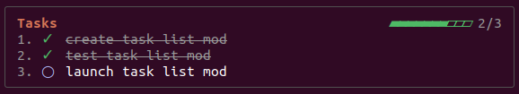

# User Task List

A Claude Code mod that shows your own task list, the things you are working on in Claude Code, in a box above the prompt, with a progress bar and ✓ for finished tasks. Tasks persist across sessions.



## Install

Needs Claude Code 2.1.287 or later. In Claude Code, run:

```
/plugin install user-task-list --marketplace jatinmayekar/claude-task-list
```

Then run `/reload-plugins`, or restart Claude Code.

## Use

| Command | Does |
|---|---|
| `/task add <text>` | Add a task |
| `/task done <n> [note]` | Toggle task n done/undone |
| `/task rm <n>` | Remove task n |
| `/task clear` | Remove finished tasks |
| `/task hide` / `/task show` | Hide or show the box |

## Data and privacy

Your tasks are saved locally in the plugin's own store on your machine. The mod makes no network requests, runs no shell commands, and sends nothing anywhere. It registers one slash command, `/task`, and handles that command itself. It hooks the `command.run` event only for `/task` and passes every other command through unchanged. It also draws the box above the prompt. The box shows in the terminal and the Desktop Code tab.

## Develop

```bash
claude plugin validate ~/mods/task-list
claude plugin test ~/mods/task-list
```

## License

MIT
